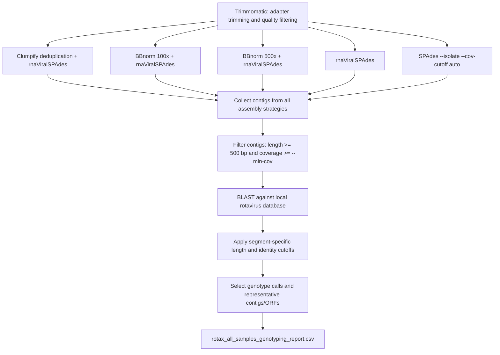
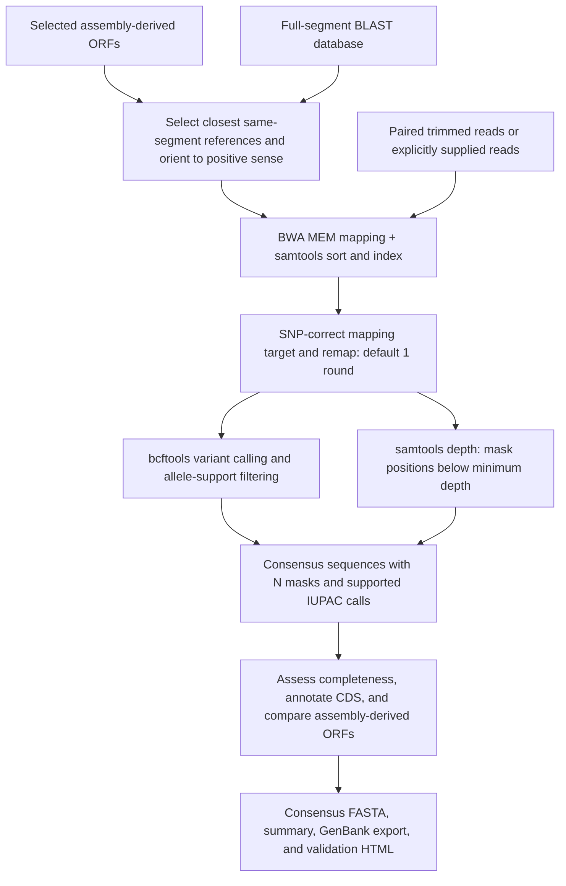

# rotax

## Latest version

- **Version:** `2026-11-11-v34-report-columns` 
- **Updated:** 2026-11-11


Verify the installed version:

```bash
python3 /mnt/tempdata/rota/rotax/rotax.py --version
```


## About

`rotax` is a command-line pipeline for genotyping Rotavirus A. The most validated use is currently G- and P-typing. Results should be interpreted with care and checked manually when important.

`rotax` genotypes Rotavirus A from Illumina paired-end data or from already assembled contigs. It performs de novo assembly with several SPAdes/rnaViralSPAdes strategies, collects contigs, filters them by length and coverage, and then performs genotyping with BLAST against a local rotavirus database.


If a segment is not detected, the genotype is reported as `X`, for example `GX` or `PX`. If several possible genotypes are detected for the same segment and the pipeline cannot select one clear result, the segment is reported as `?`, for example `G?`, and the alternatives are listed in `Extra Information`.

Cutoffs are based on the genotype-assignment principles described by Matthijnssens et al. 2008:

https://pubmed.ncbi.nlm.nih.gov/18604469/


## Install

You will need conda. Dependencies are described in `env.yaml` and can be installed with:

```bash
conda env create -f env.yaml
```

Activate the environment before running the pipeline:

```bash
conda activate rotax
```

## Create the BLAST databases (If updating the database)

Keep each source FASTA beside its database with the same prefix and
the `.fasta` extension: RotaX uses it to retrieve reference sequences for mapping
and alignment. Preserve the genotype prefixes and vaccine markers in headers.
Rebuild the corresponding database whenever its source FASTA changes.

Run these commands in the `rotax` conda environment, which must provide
`makeblastdb` and `blastdbcmd` from NCBI BLAST+. They build or rebuild the indexes
from the existing reference FASTA files. Make sure the fasta headers are formatted as shown in this repository.

mamba activate rotax
makeblastdb -in blastdb/References_all_segments_plus_vaccine.fasta -dbtype nucl -out blastdb/References_all_segments_plus_vaccine

The script can auto-detect these databases when each directory contains only
one indexed database prefix. To select them explicitly, run the following from
the parent directory containing the sample folders:

```bash
python3 /mnt/tempdata/rota/rotax/rotax.py \
    --blast-db /path/to/rotax/blastdb/References_all_segments_plus_vaccine \
    --full-segment-db /path/to/rotax/fulldb/rotavirus_full_segments
```

Pass the database **prefix**, without `.fasta`, `.nin`, or `.nsq`, to these
options. The genotyping and full-segment databases serve different purposes;
keep them in their respective directories.

## Use

Run `rotax.py` from the parent directory containing one folder per sample.

Each sample folder should contain paired-end FASTQ files matching:

```text
*_R1_001.fastq.gz
*_R2_001.fastq.gz
```

Typical use:

```bash
python3 /path/to/rotax/rotax.py
```

Without `--blast-db`, the script looks for a unique indexed database prefix in
`/mnt/tempdata/rota/rotax/blastdb/`. An unindexed FASTA alone is insufficient.
The database must contain RotaTeq references for all 11 segments to report all
11 vaccine identities, alongside the other references used for comparison.

If `contigs500.fasta` already exists in each sample folder and you only want to rerun genotyping:

```bash
python3 /path/to/rotax/rotax.py --skip-assembly --overwrite-existing --blast-db /path/to/db
```

Useful options:

```text
--blast-db        Path/prefix of the rotavirus BLAST database.
--threads         Threads for SPAdes/rnaViralSPAdes. Default: 12.
--min-cov         Minimum contig k-mer coverage parsed from the SPAdes header. Default: 3.
--skip-assembly   Skip assembly and start from existing contigs500.fasta files.
--no-cleanup      Keep intermediate FASTQ files and SPAdes work folders.
--fasta-input     Genotype an existing FASTA without assembly.
--no-mapping      Disable read-mapping consensus (e.g. FASTA-only typing).
--overwrite-existing  Replace existing pipeline outputs and rerun; with --skip-assembly, preserve contigs500.fasta.
--skip-existing   Skip samples that already have outputs.
```

## Output

### Main directory

The final report is written to the directory where the pipeline is run:

```text
rotax_all_samples_genotyping_report.csv
```

This is the main all-samples report, with one row per sample. Its 19 columns,
in order, are:

```text
Folder Name,LabwareGenotype,Genotype,Extra Information,Rotarix VP7,Rotarix VP4,RotaTeq VP7,RotaTeq VP4,RotaTeq VP6,RotaTeq VP1,RotaTeq VP2,RotaTeq VP3,RotaTeq NSP1,RotaTeq NSP2,RotaTeq NSP3,RotaTeq NSP4,RotaTeq NSP5,Art,G3 equine-like
```

- `Folder Name`: sample folder name.
- `LabwareGenotype`: full constellation for a single genotype per segment, or the `Koinfeksjon(...)` display described below.
- `Genotype`: original 11-segment call, retained for downstream mapping and interpretation.
- `Extra Information`: additional accepted genotype calls, including alternatives to tied `?` calls; `None` when absent.
- `Rotarix VP7`, `Rotarix VP4`: mean percent identity of accepted G1/P8 hits containing `RIX4414`.
- Eleven `RotaTeq` columns: highest qualifying percent identity for each segment; blank when no qualifying closest RotaTeq match exists. See the matching rules below.
- `Art`: retains the previous rule based on the original primary constellation: `RVA` when both primary G and P are resolved numeric genotypes, otherwise `UTILSTREKV`. A mixture with tied primary calls can therefore remain `UTILSTREKV`.
- `G3 equine-like`: `y` when the selected G3 hit is equine-like; otherwise blank.

The per-sample report has the same first 17 columns. Empty samples use the same
schema, with blank genotype/vaccine fields and `Extra Information=None`.
When combining older sample reports, the script reconstructs the new display
and recomputes RotaTeq identities from retained evaluated BLAST hits. If that
evidence is missing, it logs a warning and leaves RotaTeq fields blank.

The main log file is:

```text
rotax_pipeline_log.txt
```

### Sample folders

More detailed files are generated inside each sample folder:

```text
contigs.fasta
```

All contigs collected from the different SPAdes/rnaViralSPAdes assembly strategies.

```text
contigs500.fasta
```

All contigs with length of at least 500 bp.

```text
contigs500_COV.fasta
```

All contigs passing the minimum coverage cutoff. The default cutoff is coverage >= 3, controlled by `--min-cov`.

```text
rotavirus_blast_raw.tsv
```

Raw BLAST output from `contigs500_COV.fasta` against the local rotavirus database. This file is removed during cleanup unless `--no-cleanup` is used.

```text
rotavirus_blast_evaluated.csv
```

BLAST results with an added `Evaluation` column. Accepted hits receive a genotype call. Rejected hits are marked as `not accepted`.

```text
not_accepted_typing_report.csv
```

Detailed report for rejected BLAST hits. This includes the original BLAST line, parsed genotype/gene/identity/length values, and which acceptance criteria passed or failed.

```text
rotavirus_genotype_hit_summary.csv
```

Counts of accepted full and partial contigs for each genotype, separated by high and low coverage. This file is used to choose the final genotype per segment.

```text
rotax_sample_genotyping_report.csv
```

Final per-sample genotype report, including the coinfection display, preserved constellation, and all 11 RotaTeq fields. These files are combined into `rotax_all_samples_genotyping_report.csv`.

```text
rotavirus_selected_contigs.fasta
```

One selected contig per detected genotype. Full-length contigs are preferred over partial contigs. Among full-length contigs, higher coverage is preferred.

```text
rotavirus_selected_orfs.fasta
```

The selected contig regions corresponding to the BLAST hit coordinates. Sequences are reverse-complemented when the BLAST hit is on the minus strand.

Read mapping is enabled by default when reads and a full-segment database are
available. Its outputs are stored under each sample's `mapping/` folder,
including consensus FASTA, GenBank FASTA/features, mapping summary, and the
interactive validation HTML. 

## Genotype selection logic

For each segment, `rotax` first groups accepted BLAST hits by genotype. It then prioritizes genotypes using this order:

1. high-coverage full-length hits
2. low-coverage full-length hits
3. high-coverage partial hits
4. low-coverage partial hits

If one genotype is clearly best, it is reported in the final genotype constellation.

If no genotype is detected for a segment, that segment is reported as `X`.

If several genotypes tie for the best evidence, that segment is reported as `?`, and the alternatives are listed in `Extra Information`.

Additional lower-priority genotypes detected in the same sample are also listed in `Extra Information`.

## Coinfection display

Two or more distinct numeric genotypes in **any** segment trigger the
`Koinfeksjon(...)` display in `LabwareGenotype` in both sample and all-samples reports. Evidence comes
from the original selected constellation plus accepted alternatives in
`Extra Information`. `X` or `?` by itself does not establish a mixture. The
existing acceptance thresholds and genotype selection priorities are unchanged.

The primary selected call is listed first, followed by additional calls in
numeric order; tied calls are listed in numeric order. P types always use
brackets. Formatting consistently uses no space before `(` and a hyphen between
G and P:

| Detected calls | `LabwareGenotype` |
|---|---|
| Primary G2/P8, additional G4/P4 | `Koinfeksjon(G2G4-P[8]P[4])` |
| Primary G1/P8, additional G3 | `Koinfeksjon(G1G3-P[8])` |
| G3/P8, mixed I1/I2 and N1/N2 | `Koinfeksjon(G3-P[8])` |

Internal-segment mixtures still trigger the coinfection label even if only one
G type and one P type are detected. The original constellation remains in
`Genotype`, and alternative calls remain in `Extra Information`. No undetected
G/P calls are added to the display. There is no separate coinfection comment column.

## Vaccine-like reference matches

Rotarix matching is unchanged: `Rotarix VP7` is the mean percent identity among
accepted G1 hits containing `RIX4414`, and `Rotarix VP4` uses accepted P8 hits
with that marker. Marker matching is case-insensitive.

RotaTeq covers all 11 segments, in constellation order:

| Genotype prefix | Output column |
|---|---|
| G | `RotaTeq VP7` |
| P | `RotaTeq VP4` |
| I | `RotaTeq VP6` |
| R | `RotaTeq VP1` |
| C | `RotaTeq VP2` |
| M | `RotaTeq VP3` |
| A | `RotaTeq NSP1` |
| N | `RotaTeq NSP2` |
| T | `RotaTeq NSP3` |
| E | `RotaTeq NSP4` |
| H | `RotaTeq NSP5` |

For each selected contig/segment, retained same-segment BLAST hits are ranked by
**bitscore first, percent identity second**. A value is eligible only when the
closest reported reference contains `RotaTeq` (case-insensitive) and its hit
passes the existing acceptance criteria. Any reported exact top-score tie with
a non-RotaTeq reference is excluded for that contig. A lower-ranked vaccine hit
does not qualify. If multiple selected contigs qualify for a segment, the cell
contains **only the highest percent identity**, without averaging. Missing or
nonqualifying matches are blank, not zero.

Values are BLAST nucleotide `pident` percentages over the aligned region;
they are not whole-segment coverage percentages. The genotyping BLAST retains
one target per contig (`-max_target_seqs 1`), so "closest" refers to the top
reported reference in the database used. Unreported ties cannot be assessed.
The evaluated BLAST CSV retains the contig/reference evidence. The new rule
also replaces the old average used for `RotaTeq VP6`.

Headers with a segment-only prefix, such as `G|RotaTeq-...` or
`R|RotaTeq-...`, can supply vaccine identity evidence without inventing numeric
genotypes. Numeric genotype reporting still requires correctly typed reference
headers. Adding a FASTA file to the database directory does not add it to an
existing BLAST index: the references must be included when building that index.

## Important notes

`not accepted` means that the BLAST hit did not pass the current criteria for being carried forward as a genotype call. The details are written to `not_accepted_typing_report.csv`.


## NGS bioinformatics pipeline for genotyping Rotavirus A



## NGS read mapping and consensus generation for Rotavirus A

After genotyping, `rotax` uses the selected assembly-derived ORFs to choose
full-segment references, then maps paired-end reads to those references to
produce consensus sequences. Mapping is enabled by default and
requires a full-segment BLAST database, paired reads, BWA, samtools, and bcftools.
MAFFT is used for CDS annotation and alignment-based validation.

1. **Choose mapping references.** Each selected ORF is BLASTed against the
   full-segment database. The closest same-segment reference is selected by
   bitscore, then percent identity, and oriented to positive sense. Identical
   reference sequences selected for the same segment are merged. All selected
   references are included in a shared mapping index for the sample.
2. **Map paired reads.** The pipeline prefers Trimmomatic paired reads, then
   repaired trimmed reads, then Clumpify-deduplicated reads. BWA MEM maps the
   reads, and samtools sorts and indexes the BAM. Explicit `--mapping-r1` and
   `--mapping-r2` inputs override this selection. Raw FASTQ fallback requires
   `--allow-raw-fastq-mapping`.
3. **Polish and remap.** By default, one polishing round applies called SNPs to
   the mapping target and remaps the reads. This can recover read ends that
   aligned poorly to the original reference. Indels are excluded from this
   intermediate target to preserve reference coordinates. Set
   `--mapping-polish-rounds 0` to disable polishing.
4. **Call the consensus.** bcftools calls variants and applies them to the
   mapping target. Positions below `--mapping-min-depth` (default: 5 reads)
   are masked with `N`. For a called two-allele genotype, an IUPAC ambiguity is
   retained only when the less-supported allele has at least 5 high-quality
   allele-depth reads and at least 20% of the combined called-allele depth;
   otherwise, the allele with greater read support is used.
5. **Assess completeness and annotate.** A consensus is classified as full
   when at least 99% of the selected reference is covered at the minimum depth
   and no more than 5 bases are missing at either end. These thresholds are
   controlled by `--mapping-ref-cov-full` and
   `--mapping-max-missing-end-bases`. Protein alignments to the best
   same-segment genotyping-database ORF guide CDS annotation. The pipeline also
   compares the mapping-derived ORF with the selected assembly-derived ORF.
6. **Export and review.** Consensus FASTA files, coverage and annotation tables,
   and an interactive validation HTML are written to the sample's `mapping/`
   folder. Possible mixed infections are mapped but remain review-only for
   GenBank by default. The GenBank FASTA export trims terminal Ns and has a
   companion feature table with adjusted coordinates; its completeness labels
   are distinct from the mapping coverage classification.



The main per-sample outputs are:

| File in `mapping/` | Contents |
|---|---|
| `rotavirus_mapping_consensus.fasta` | All mapping consensus sequences, including partial sequences. |
| `rotavirus_mapping_consensus_full.fasta` | Sequences meeting the mapping completeness thresholds. |
| `rotavirus_mapping_consensus_partial_or_review.fasta` | Partial sequences and sequences requiring review. |
| `rotavirus_mapping_summary.csv` | Reference selection, coverage, completeness, and GenBank readiness information. |
| `rotavirus_mapping_depth.tsv` | Per-position depth information. |
| `rotavirus_mapping_consensus_features.csv` | Source and CDS feature coordinates. |
| `rotavirus_mapping_consensus_genbank.fasta` | Terminal-N-trimmed sequences with complete/partial labels for GenBank preparation. |
| `rotavirus_mapping_consensus_genbank_features.csv` | Feature coordinates adjusted for terminal trimming. |
| `rotavirus_mapping_validation.html` | Interactive reference/consensus alignment, ORF comparison, and depth views. |

Combined outputs in the main run directory are
`rotax_mapping_consensus_all.fasta`, `rotax_mapping_consensus_full.fasta`,
`rotax_mapping_summary.csv`, and `rotax_mapping_consensus_features.csv`.
Use `--no-mapping` to disable consensus generation or `--no-mapping-validation`
to omit the validation HTML.
