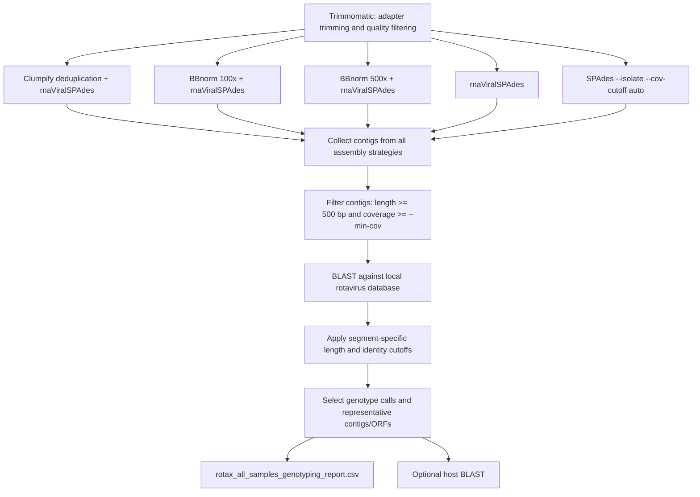

# rotax

## About

**Warning:** `rotax` is a command-line pipeline for genotyping Rotavirus A and is still under validation. The most validated use is currently G- and P-typing. Results for the remaining genome segments should be interpreted with extra care and checked manually when important.

`rotax` genotypes Rotavirus A from Illumina paired-end data or from already assembled contigs. It performs de novo assembly with several SPAdes/rnaViralSPAdes strategies, collects contigs, filters them by length and coverage, and then performs genotyping with BLAST against a local rotavirus database.

The pipeline reports the full 11-segment Rotavirus A genotype constellation:

```text
G-P-I-R-C-M-A-N-T-E-H
```

If a segment is not detected, the genotype is reported as `X`, for example `GX` or `PX`. If several possible genotypes are detected for the same segment and the pipeline cannot select one clear result, the segment is reported as `?`, for example `G?`, and the alternatives are listed in `Extra Information`.

Cutoffs are based on the genotype-assignment principles described by Matthijnssens et al. 2008:

https://pubmed.ncbi.nlm.nih.gov/18604469/

The BLAST database is not embedded in the script and must be provided separately.

## Install

You will need conda. Dependencies are described in `env.yaml` and can be installed with:

```bash
conda env create -f env.yaml
```

Activate the environment before running the pipeline:

```bash
conda activate rotax
```

## Use

Run `rotax.py` from the parent directory containing one folder per sample.

Each sample folder should contain paired-end FASTQ files matching:

```text
*_R1_001.fastq.gz
*_R2_001.fastq.gz
```

Typical use:

```bash
python3 /path/to/rotax.py --blast-db /path/to/241130_rotadb
```

Optional host database:

```bash
python3 /path/to/rotax.py \
    --blast-db /path/to/241130_rotadb \
    --host-db /path/to/hostdb/hostdatabase250421
```

If `contigs500.fasta` already exists in each sample folder and you only want to rerun genotyping:

```bash
python3 /path/to/rotax.py --skip-assembly --blast-db /path/to/241130_rotadb
```

Useful options:

```text
--blast-db        Path/prefix of the rotavirus BLAST database.
--host-db         Optional path/prefix of a host BLAST database.
--threads         Threads for SPAdes/rnaViralSPAdes. Default: 12.
--min-cov         Minimum contig k-mer coverage parsed from the SPAdes header. Default: 3.
--skip-assembly   Skip assembly and start from existing contigs500.fasta files.
--no-cleanup      Keep intermediate FASTQ files and SPAdes work folders.
```

## Output

### Main directory

The final report is written to the directory where the pipeline is run:

```text
rotax_all_samples_genotyping_report.csv
```

This is the main all-samples report. It contains one row per sample and includes:

- `Folder Name`: sample folder name
- `Genotype`: full 11-segment genotype constellation
- `Extra Information`: additional detected genotypes when more than one genotype was detected for a segment
- `Rotarix VP7`: percent identity to the RIX4414 VP7 reference, if relevant
- `Rotarix VP4`: percent identity to the RIX4414 VP4 reference, if relevant
- `RotaTeq VP6`: percent identity to the RotaTeq VP6 reference, if relevant
- `G_P_Genotype`: only the G/P part of the genotype constellation
- `ResultCategory`: generic result category, currently `RVA` when both G and P are resolved, otherwise `UTILSTREKV`

The main log file is:

```text
rotax_pipeline_log.txt
```

### Sample folders

More detailed files are generated inside each sample folder:

```text
contigs.fasta
```

All contigs collected from the different SPAdes/rnaViralSPAdes assembly strategies.

```text
contigs500.fasta
```

All contigs with length of at least 500 bp.

```text
contigs500_COV.fasta
```

All contigs passing the minimum coverage cutoff. The default cutoff is coverage >= 3, controlled by `--min-cov`.

```text
rotavirus_blast_raw.tsv
```

Raw BLAST output from `contigs500_COV.fasta` against the local rotavirus database. This file is removed during cleanup unless `--no-cleanup` is used.

```text
rotavirus_blast_evaluated.csv
```

BLAST results with an added `Evaluation` column. Accepted hits receive a genotype call. Rejected hits are marked as `not accepted`.

```text
not_accepted_typing_report.csv
```

Detailed report for rejected BLAST hits. This includes the original BLAST line, parsed genotype/gene/identity/length values, and which acceptance criteria passed or failed.

```text
rotavirus_genotype_hit_summary.csv
```

Counts of accepted full and partial contigs for each genotype, separated by high and low coverage. This file is used to choose the final genotype per segment.

```text
rotax_sample_genotyping_report.csv
```

Final per-sample genotype report. These files are combined into `rotax_all_samples_genotyping_report.csv`.

```text
rotavirus_selected_contigs.fasta
```

One selected contig per detected genotype. Full-length contigs are preferred over partial contigs. Among full-length contigs, higher coverage is preferred.

```text
rotavirus_selected_orfs.fasta
```

The selected contig regions corresponding to the BLAST hit coordinates. Sequences are reverse-complemented when the BLAST hit is on the minus strand.

```text
host_blast_comparison.csv
```

Optional. Created only when `--host-db` is supplied. The selected ORF sequences are blasted against the host database, and the closest hits are written here.

## Genotype selection logic

For each segment, `rotax` first groups accepted BLAST hits by genotype. It then prioritizes genotypes using this order:

1. high-coverage full-length hits
2. low-coverage full-length hits
3. high-coverage partial hits
4. low-coverage partial hits

If one genotype is clearly best, it is reported in the final genotype constellation.

If no genotype is detected for a segment, that segment is reported as `X`.

If several genotypes tie for the best evidence, that segment is reported as `?`, and the alternatives are listed in `Extra Information`.

Additional lower-priority genotypes detected in the same sample are also listed in `Extra Information`.

## Vaccine-like reference matches

Rotarix-like matches are identified using the marker `RIX4414` in the BLAST subject header.

RotaTeq-like VP6 matches are identified using the marker `RotaTeq` in the BLAST subject header.

The final reports can include percent identity values for:

- `Rotarix VP7`
- `Rotarix VP4`
- `RotaTeq VP6`

These values are reported only when the expected genotype/segment and reference-marker combination is found among accepted BLAST hits.

## Important notes

`not accepted` means that the BLAST hit did not pass the current criteria for being carried forward as a genotype call. The details are written to `not_accepted_typing_report.csv`.


## NGS bioinformatics pipeline

